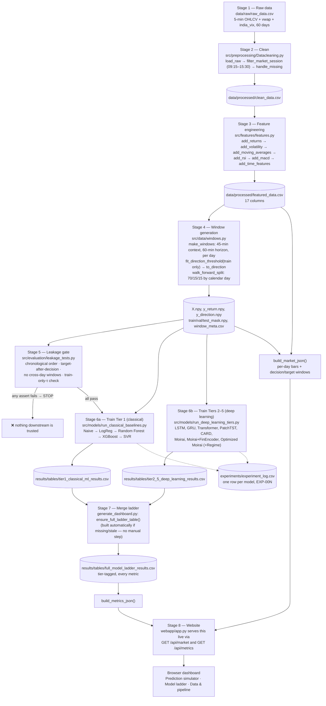
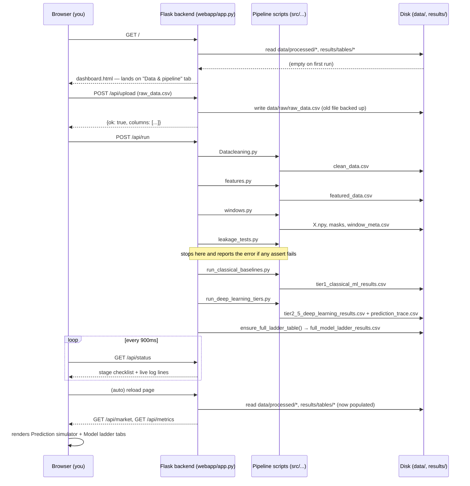

# Optimized Moirai — Intraday Financial Forecasting

A five-tier model ladder for 60-minute-ahead direction forecasting on 5-minute
intraday bars — **Naive → Logistic Regression → Random Forest → XGBoost → SVR
→ LSTM → GRU → Transformer → PatchTST → CARD → Moirai → Optimized Moirai** —
plus a website that turns the pipeline's output into an interactive
prediction simulator and model comparison dashboard.

This README covers two things: **how the pipeline's data flows from raw CSV
to trained models**, and **how the website sits on top of it**.

---

## 1. Data flow — raw CSV to trained models

Everything downstream is deterministic given `data/raw/raw_data.csv` and a
fixed seed (`SEED = 42`). Each stage reads the previous stage's output from
disk and writes its own; nothing is passed in memory between stages, which
is what lets the website re-run any stage independently and lets
`generate_dashboard.py` / `webapp/app.py` rebuild dashboard data from disk at
any time.



**The one rule enforced at every stage:** anything computed from training
data (scaler stats, the direction threshold τ, model weights) is fit once on
`train` and only ever *applied* — never refit — to `val`/`test`. Stage 5
exists specifically to catch violations of this before any model sees the
data.

---

## 2. The website — how a browser click turns into a pipeline run

The website (`webapp/`) doesn't add a second copy of any pipeline logic. It
imports `build_market_json` / `build_metrics_json` / `build_prediction_json` / `ensure_full_ladder_table`
directly from `src/visualization/generate_dashboard.py`, and it runs Stages
2–6 as real subprocesses — the same commands you'd type in a terminal.



---

## 3. Directory structure

```
Computational-Finance-research-paper/
├── data/
│   ├── raw/raw_data.csv                 # Stage 1 — only real input; replace to use new data
│   └── processed/                       # Stages 2–4 output (regenerated by the pipeline)
├── src/
│   ├── preprocessing/Datacleaning.py    # Stage 2
│   ├── features/features.py             # Stage 3
│   ├── data/windows.py                  # Stage 4
│   ├── models/
│   │   ├── run_classical_baselines.py   # Stage 6a — Tier 1
│   │   ├── run_deep_learning_tiers.py   # Stage 6b — Tiers 2–5
│   │   ├── architectures.py             # LSTM/GRU/Transformer/PatchTST/CARD/Moirai classes
│   │   └── common.py                    # shared train/evaluate loop for Tiers 2–5
│   ├── evaluation/
│   │   ├── leakage_tests.py             # Stage 5 (hard gate)
│   │   ├── metrics.py
│   │   └── prediction_trace.py          # timestamp-level forecast persistence
│   └── visualization/
│       ├── generate_dashboard.py        # Stage 7/8 — merges ladder table, builds dashboard JSON
│       └── dashboard_template.html      # used by generate_dashboard.py for a static export
├── results/
│   ├── tables/                          # per-tier + merged model ladder CSVs
│   ├── predictions/                     # timestamp-level model forecast trace
│   └── dashboard/                       # static HTML export (optional, see below)
├── experiments/experiment_log.csv       # one row per trained model, auto-incrementing EXP-00N
└── webapp/                              # the website
    ├── app.py                           # Flask backend — see section 2
    ├── templates/dashboard.html         # the entire frontend: 3 tabs, one page
    └── requirements.txt                 # just Flask
```

---

## 4. How to run

### Option A — the website (recommended)

```bash
cd Computational-Finance-research-paper
pip install -r requirements.txt          # pandas, numpy, scikit-learn, xgboost, torch
pip install -r webapp/requirements.txt   # Flask
python webapp/app.py
```

Open **http://localhost:5000/**. Two dashboard tabs plus the separate pipeline page:

- **Prediction simulator** — select any historical trading day and any 5-minute
  decision checkpoint (the first research checkpoint is 10:00). The dashboard
  loads the trained model's persisted timestamp-level prediction, overlays the
  predicted next-60-minute direction/return on the intraday chart, and reveals
  the actual target only when the target timestamp is reached.
- **Model ladder** — direction accuracy, F1, MASE, latency, CRPS/coverage, plus
  a metric-deviation heatmap showing standardized spread around the peer mean.
- **Data & pipeline** — upload a new `raw_data.csv` and run Stages 2–6 from
  the browser, with a live stage checklist and log console. The page reloads
  itself when the run finishes.

If `data/processed/` and `results/tables/` are already populated (true for
this zip as delivered), the first two tabs work immediately. If they're
empty, the site lands on the "Data & pipeline" tab automatically.

### Option B — command line, stage by stage

```bash
cd Computational-Finance-research-paper
python src/preprocessing/Datacleaning.py
python src/features/features.py
python src/data/windows.py
python src/evaluation/leakage_tests.py         # stop if this fails
python src/models/run_classical_baselines.py
python src/models/run_deep_learning_tiers.py
python src/visualization/generate_dashboard.py # writes results/dashboard/intraday_direction_ladder.html
```

The last command produces a single self-contained HTML file you can open
directly, email, or archive — no server needed. It's a snapshot at the time
you ran it; the website (Option A) always reflects whatever's on disk right
now.

---

## 5. About the dataset

`data/raw/raw_data.csv` is **synthetic**, not real market data — see
`README_dataset.md` for what it reproduces and where to get real NSE Nifty-50
minute data instead. No code changes are needed to swap it in: keep the same
column names (`timestamp, open, high, low, close, volume, ...`) and either
replace the file directly or upload it through the "Data & pipeline" tab.

## 6. Historical prediction trace and forecast visualisation

`results/predictions/prediction_trace.csv` is the bridge between the research
metrics and the interactive simulator. Each row represents one decision
window from `window_meta.csv` and stores the model's predicted direction,
predicted return (when the model is a regression forecaster), class
probabilities/confidence, and Moirai quantiles where available. The split
column keeps the original walk-forward train/validation/test designation.

This means the dashboard no longer creates a synthetic/random prediction at
10:00. For a selected date, it retrieves the actual saved prediction for
10:00 (or any later 5-minute checkpoint), draws the predicted next-hour
trajectory, and then compares it with the real target when the playback reaches
that target timestamp. Train-day predictions are in-sample; validation/test
predictions are out-of-sample under the existing chronological split.

The model stage scripts regenerate the trace automatically whenever the
pipeline is run. For the included dashboard artifact, the deep-learning trace
was generated with `CF_EPOCHS=5 CF_PATIENCE=2` to keep the shipped demo
artifact reproducible within a practical runtime; the code defaults remain
25 epochs / 5-patience for a fuller research run.

The comparison tab's **Metric deviation heatmap** computes, independently for
each metric, `z = (model value - peer mean) / peer standard deviation`. This
visualisation is intentionally scale-free: MAE, RMSE, MASE, accuracy/F1, CRPS,
and inference time can be inspected together without pretending they share the
same raw units.


## Dashboard: future 2025–2026 scenario mode

The web dashboard now has two modes:

- **Historical / observed**: choose any date present in `data/processed/featured_data.csv` and inspect the persisted timestamp-level model trace.
- **Future scenario (2025–2026)**: choose any weekday date in 2025 or 2026, a historical seed day, a model, and a decision checkpoint. The system recursively generates a 5-minute scenario from the selected model's rolling 60-minute forecasts.

Future scenario prices are **not observed market data**. Future OHLCV and volatility inputs do not exist in the supplied historical dataset, so the UI explicitly labels these outputs as ML scenario projections.

The main price chart now uses candlesticks + volume, highlights the selected checkpoint, and draws 60-minute forecast arrows. Green arrows indicate an upward projected return and red arrows indicate a downward projected return. Where the classifier and return head disagree, the graph labels both (for example, `DOWN · cls UP`) so the two outputs are not silently conflated.

Trained artifacts used for future mode are stored in `results/models/classical/` and `results/models/deep/`. Re-running the model stages refreshes these artifacts.

## Complete-dataset future scenarios (ensemble mode) and rolling/live inference

The original future-scenario mode above seeds a 2025/2026 day from **one**
chosen historical day, which makes the output only as good as whichever day
got picked. Two additions fix this:

### 1. `forecast_future_ensemble()` — use every historical day, not one

`src/evaluation/future_forecast.py` now also exposes
`forecast_future_ensemble(project_root, future_date, model_name, n_paths=None)`.
It runs the same recursive scenario generator once per historical seed day
(all 60 by default, or the most recent `n_paths`), then reports the
**median (p50) predicted return plus a 10th/90th-percentile band** at every
decision checkpoint, along with a `consensus_direction` (majority vote
across seed days) and the full fan of individual per-seed-day paths. A
`build_session_profile()` helper is also available standalone — it returns
per-5-minute-clock-slot mean/std of return, volume, and India VIX computed
across every historical day, i.e. the dataset's actual time-of-day
distribution rather than one sample from it.

API: `GET /api/future_forecast_ensemble?date=2025-06-16&model=XGBoost&n_paths=15`
(`n_paths=0` or `n_paths=all` uses every historical day; the ensemble
re-runs the full generator per seed day, so cost scales linearly with
`n_paths` — expect roughly 1–1.5s/seed-day for classical models and more
for the deep/Moirai family).

### 2. `LiveForecaster` / `simulate_live()` — rolling inference on real data

`src/evaluation/live_inference.py` is the deploy-ready counterpart: it
predicts only from **real, observed bars**, never from a self-generated
one. `LiveForecaster.ingest_bar(bar)` is called once per real 5-minute bar
as it arrives; the moment 9 real bars exist for the current session it
emits a pending 60-minute-ahead forecast, which is resolved against the
real bar that later lands on its target timestamp (direction is scored
using the same train-only τ threshold Stage 4 fits, loaded from
`data/processed/`). `simulate_live(project_root, model_name, days=...)`
replays `data/raw/raw_data.csv` bar-by-bar through this exact path as a
validation harness — restricted to the walk-forward **test** days, it
reproduces the offline ladder's `direction_accuracy` number exactly (e.g.
XGBoost: 0.3010101... both ways), which is the proof that the streaming
code path is behaviourally identical to the batch evaluation, just fed one
bar at a time.

API: `GET /api/live_simulate?model=XGBoost&split=test` (`split=all` replays
every historical day — slower, and mixes in-sample train-day accuracy with
genuine out-of-sample accuracy, so treat that number as a plumbing sanity
check, not a result to report).

To go from `simulate_live()` (replay) to an actual live deployment: replace
the `for _, row in raw.iterrows(): forecaster.ingest_bar(row.to_dict())`
loop with a call to `forecaster.ingest_bar(bar)` inside whatever receives
your real 5-minute bars (a broker/market-data websocket handler, a polling
cron job, etc.) — `LiveForecaster` itself has no dependency on the replay
source.
